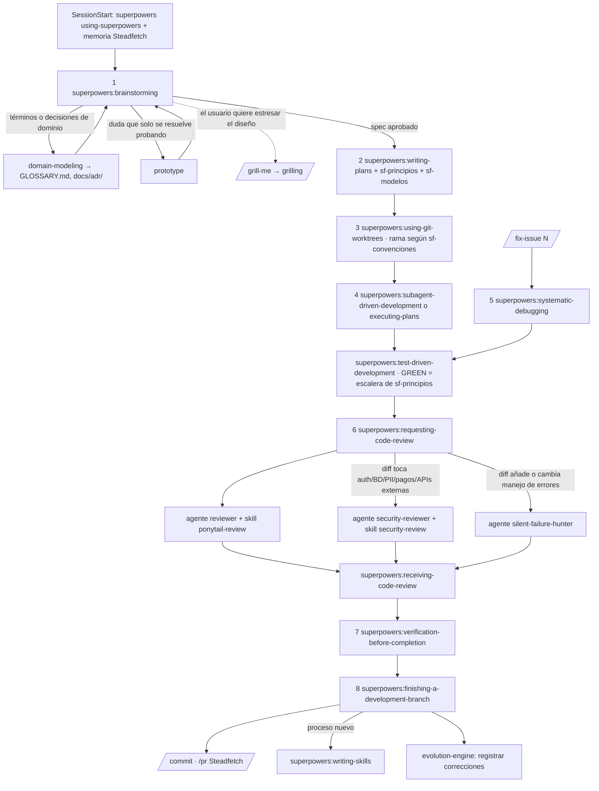

# Capa de IA de Steadfetch (`.claude/`)

Esta carpeta la gestiona `ai-template` y se sincroniza por PR en cada repo. Aquí se explica cómo encajan las piezas. Para el uso diario basta con el `README.md` de la raíz.

## El flujo

superpowers es la columna vertebral: sus skills se llaman entre sí. Los puentes hacia el resto viven en la regla `rules/sf-flujo.md`, que se carga siempre y prevalece sobre las skills.

Specs y planes van en `.superpowers/specs/` y `.superpowers/plans/` (git-ignorados), nunca en `docs/`.

Periódicas, siempre las lanza el usuario: `/evolve` (semanal), `/improve-codebase-architecture` y `/ponytail-audit` (mensual), `/ponytail-debt` (antes de una release) y `/handoff` (cuando la sesión se alarga).

Modelos, esfuerzo y paralelismo por tarea: `rules/sf-modelos.md`.

## Conflictos y precedencia

| Choque | Gana | Regla |
|---|---|---|
| TDD estricto (superpowers) contra "un test pequeño" (ponytail) | superpowers | Toda lógica nueva empieza por un test que falla. La escalera de `sf-principios` decide cuánto código se escribe en el paso GREEN |
| `brainstorming` contra `grill-me` | brainstorming | `grill-me` solo se lanza a mano. Es un complemento, no una alternativa |
| Revisores: superpowers, `/code-review` integrado, `ponytail-review`, `security-review` | `superpowers:requesting-code-review` | El revisor despachado es el agente `reviewer`. `ponytail-review` es una lente dentro de él, no un paso aparte |
| Plan breve "paso → verify" contra `writing-plans` | `writing-plans` | El formato breve vale para cambios de un solo paso. Si hay varios, plan completo |
| Memoria: `.claude/memory`, auto-memory personal de Claude | `.claude/memory` | La auto-memory personal sigue siendo personal |
| Comprimir specs, planes o reglas | Prosa completa | `sf-flujo` prohíbe comprimir artefactos persistentes |

## Qué se sincroniza y cómo

La lista está en `.github/sync/manifest.json` de la plantilla.

- **managed**: los posee la plantilla. Son `VERSION`, este `README.md`, `.gitattributes`, `rules/sf-*.md`, `skills/*`, `agents/*`, `scripts/*`, `memory/README.md` y los `memory/*.jsonl.example`. No los edites en el repo: los cambios van a la plantilla. Si un archivo managed desaparece de la plantilla, el sync lo borra del destino.
- **seed**: se copian solo si no existen y después son del proyecto: `CLAUDE.md`, `PROJECT_STATE.md`, `memory/learned-rules.md` y `memory/evolution-log.md`.
- **`settings.json`**: es la plantilla fusionada con `.claude/settings.project.json`. Los diccionarios se fusionan en profundidad, las listas se unen sin duplicados y en los escalares gana el proyecto. Para añadir permisos, hooks o plugins propios, edita `settings.project.json`, nunca `settings.json`.
- **`exclude`**: en `.claude/steadfetch-sync.json` del repo, lista de rutas managed que ese repo no quiere recibir. Una entrada que acaba en `/` es un directorio y excluye todo lo que cuelga de él (por ejemplo `.claude/skills/handoff/` para una skill que no usa). Cualquier otra entrada es la ruta exacta de un archivo (`.claude/rules/sf-docs.md`). Lo excluido ni se actualiza ni se borra.
- **Tres vías**: el estado guarda el hash de cada archivo managed tal como lo escribió la última sync. Si el repo editó un archivo y la plantilla no, se respeta la edición. Si cambiaron los dos, el archivo no se toca y el PR lo lista como conflicto.
- **`force_paths`**: para resolver un conflicto a favor de la plantilla, relanza el workflow con `force_paths` (rutas separadas por comas) y gana la plantilla. La alternativa es integrar el cambio a mano o añadir la ruta a `exclude`.
- **Skills propias del repo**: una skill con un nombre que la plantilla no usa es del proyecto y el sync no la toca. Las skills de stack (fastapi, dbt, prefect...) las instala cada repo con `npx skills add`.

## Al recibir el PR de sync

Cada desarrollador, antes de hacer `git pull` de la rama del PR o de `main` tras el merge:

1. Instala el plugin del proyecto: `claude plugin install superpowers@superpowers-dev --scope project`. Si tenía superpowers a nivel usuario, lo desactiva.

Si el repo tiene activada la fusión automática (variable `FUSIONAR_SYNC`, ver el `README.md` de la plantilla), el PR se fusiona solo cuando sus checks están en verde; la limpieza de `CLAUDE.md` sigue haciéndose después a mano.

Quien mergea el PR limpia además `CLAUDE.md`: quita las secciones que ya cubren las reglas `sf-*.md`.

## El hook SessionStart

`settings.json` define un único hook, `SessionStart` (`startup|clear|compact`), que ejecuta `scripts/session-start.sh` con `bash`. Imprime la versión de la plantilla, `memory/learned-rules.md` y las últimas violaciones registradas. Ese texto entra en el contexto de Claude al empezar, tras `/clear` y tras compactar.

Solo existe este hook porque solo `SessionStart` y `UserPromptSubmit` inyectan su salida en el contexto de Claude. Los recordatorios que no se inyectan en el contexto de Claude no sirven, así que lo que haría falta recordar vive en `rules/sf-memoria.md`. En Windows hace falta Git Bash para que `bash` exista.

## Permisos

`permissions.deny` bloquea los comandos destructivos y la lectura de `.env`, `.pem`, `.key`, `.p12` y `.pfx` con la herramienta Read. No impide que un `cat` desde Bash los lea: es una limitación conocida.
